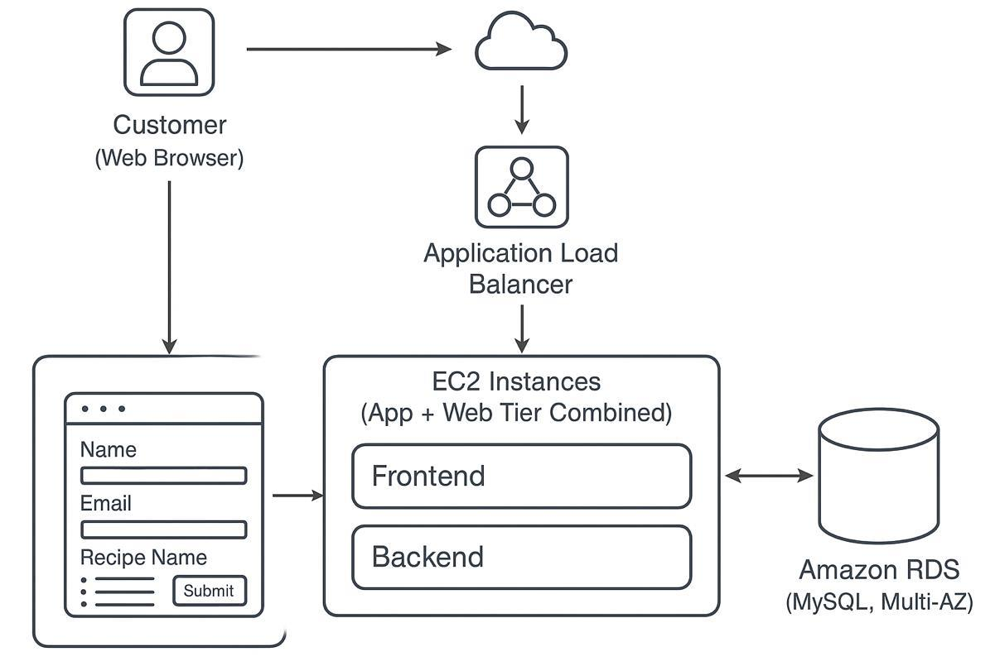
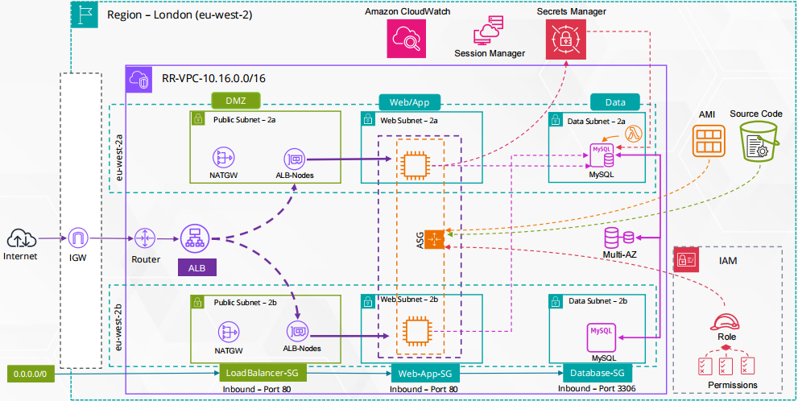
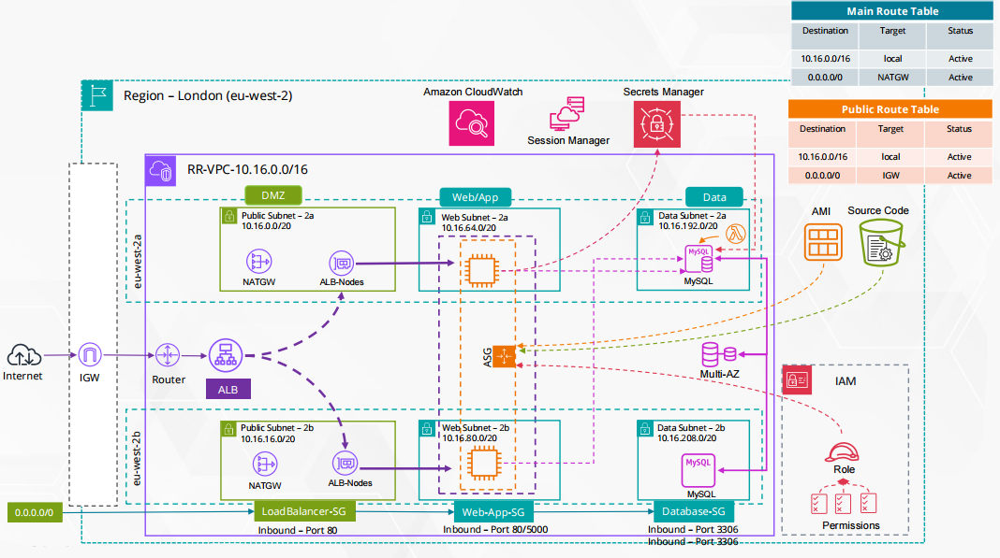
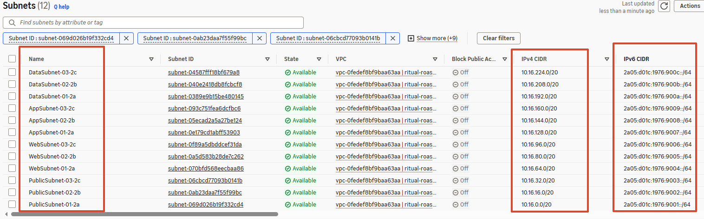
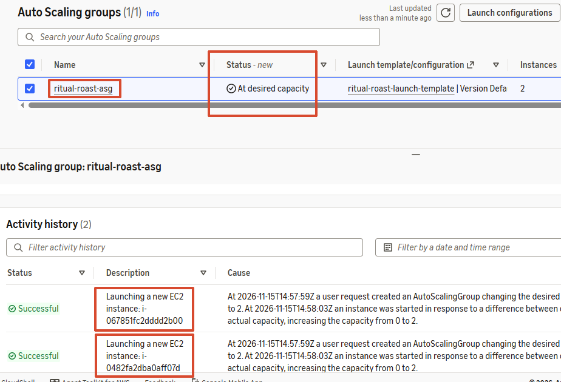
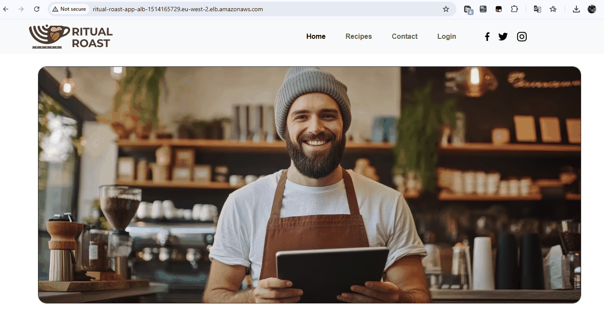
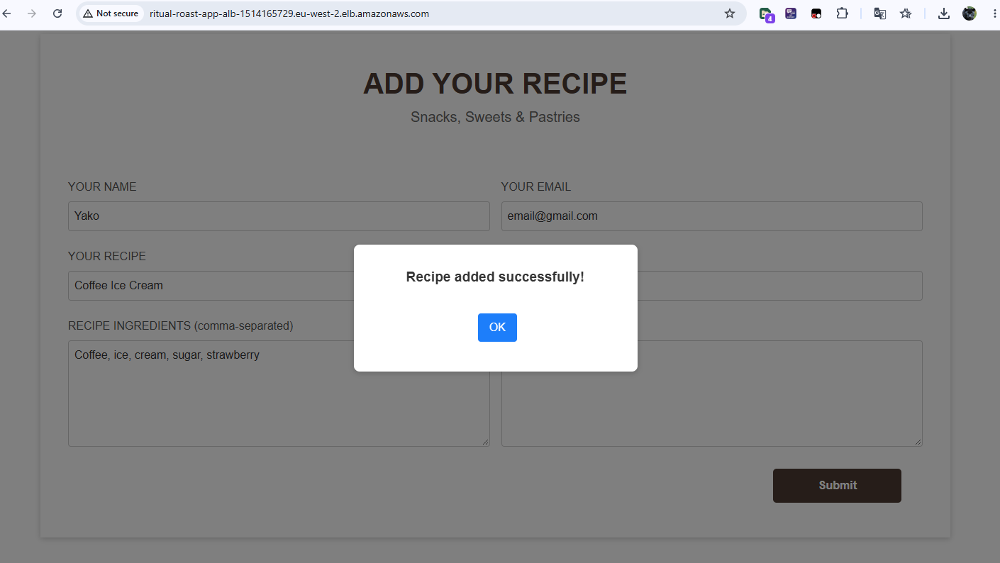
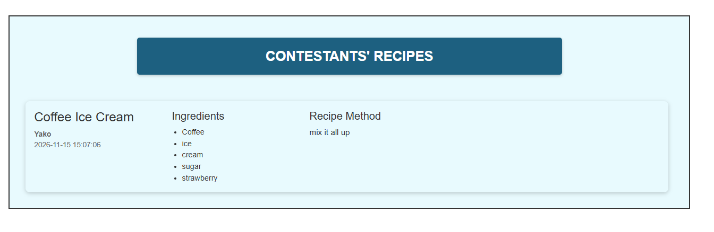
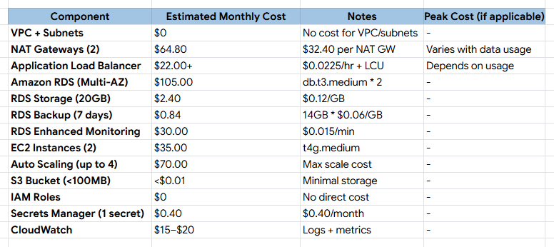

# Project 1 — Traditional 3-Tier Architecture on EC2

> **Stage 1 of 3** · Highly available, secure web application built from classic AWS building blocks: custom VPC, Application Load Balancer, Auto Scaling Group on EC2, and a Multi-AZ RDS MySQL database.

[← Back to the main README](../README.md) · Next: [Project 2 — Containers on ECS Fargate →](../02-containerized-ecs-fargate/README.md)


---

## 1. The application

**Ritual Roast "Create & Share" recipe contest** is a small web app for a fictional coffee-shop brand. Visitors submit a snack, dessert or beverage recipe through a form, and every submission appears in a public gallery so the head chef can pick a winner.

| Feature | Description |
| :--- | :--- |
| Recipe submission form | Name, email (contact only), recipe title, ingredients, description → success message |
| Recipe gallery | Table of all submissions, newest first |
| Contest countdown | Countdown timer to the contest deadline |

### Customer flow



1. The customer opens the site in a browser.
2. The **Application Load Balancer** receives all traffic and spreads it across EC2 instances in two Availability Zones.
3. Each **EC2 instance** runs both the React frontend and the Flask backend as one service (web + app tier combined).
4. The backend reads and writes recipes in a **Multi-AZ Amazon RDS for MySQL** database.

---

## 2. Architecture

### High-level design



### Low-level design



### Design decisions

| Decision | Why |
| :--- | :--- |
| Custom VPC `10.16.0.0/16` with public / web / app / data subnets across 2 AZs | Network isolation by tier and fault tolerance against an AZ failure |
| EC2 instances in **private** subnets, reachable only through the ALB | No direct internet exposure for compute |
| **NAT Gateway** for outbound traffic | Instances can pull code and call AWS APIs without a public IP |
| Chained **security groups** (`LoadBalancer-SG → Web-App-SG → Database-SG`) | Each tier only accepts traffic from the tier in front of it |
| **Auto Scaling Group** + launch template + user data | Self-healing, repeatable servers; any instance can be replaced automatically |
| Application code in **S3**, pulled at boot | Simple deployment pipeline without a CI/CD system |
| **RDS Multi-AZ** with automatic failover | Database survives an AZ outage |
| **Secrets Manager** with 7-day rotation | No hard-coded database credentials; rotation handled automatically |
| **IAM instance profile** + **Session Manager** | No access keys on servers and no SSH / bastion host |

---

## 3. AWS services used

| Layer | Service | Role in the project |
| :--- | :--- | :--- |
| Network | VPC, subnets, Internet Gateway, NAT Gateway, route tables | Isolated multi-AZ network |
| Edge | Application Load Balancer + target group | Public entry point, health checks, traffic distribution |
| Compute | EC2 (Amazon Linux, `t2.micro`) + Auto Scaling Group + launch template | Runs the Flask + React application |
| Data | RDS for MySQL (Multi-AZ, `db.t3.micro`) | Stores recipes |
| Storage | S3 (versioning on) | Holds the application source code |
| Security | Security groups, IAM role / instance profile, Secrets Manager, Session Manager | Least-exposure networking, identity and secret management |
| Observability | CloudWatch | Instance and load balancer metrics |

---

## 4. Implementation walkthrough

Each step has its own page with the exact settings I used and console screenshots.

| # | Step | Details |
| :--: | :--- | :--- |
| 1 | VPC, subnets, gateways, route tables, security groups | [docs/vpc-configuration.md](docs/vpc-configuration.md) |
| 2 | S3 bucket for the application code | [docs/s3-configuration.md](docs/s3-configuration.md) |
| 3 | RDS MySQL, subnet group and Secrets Manager rotation | [docs/rds-configuration.md](docs/rds-configuration.md) |
| 4 | IAM role for EC2 | [docs/iam-configuration.md](docs/iam-configuration.md) |
| 5 | Target group and Application Load Balancer | [docs/alb-configuration.md](docs/alb-configuration.md) |
| 6 | Launch template and Auto Scaling Group | [docs/asg-configuration.md](docs/asg-configuration.md) |

### Highlights from the build

<table>
  <tr>
    <td width="50%"><br><sub><b>12 subnets</b> across 4 tiers and 3 AZs</sub></td>
    <td width="50%"><br><sub><b>Auto Scaling Group</b> launching and replacing instances</sub></td>
  </tr>
</table>

### How the application boots

```text
Launch template ─▶ user-data.sh
                     ├─ install pip / AWS CLI
                     ├─ aws s3 sync s3://rr-1-source-code → /home/ec2-user/myflaskapp
                     ├─ pip install -r requirements.txt
                     └─ nohup python3 ritual-roast.py   (listens on :5000)
```

### The application

The Flask app serves two roles at once:

- **Static host** for the compiled React build (`app/flask/ritual_roast/build`)
- **REST API** backed by MySQL

| Method | Route | Description |
| :--- | :--- | :--- |
| `GET` | `/get_recipe` | Returns all recipes, newest first |
| `POST` | `/add_recipe` | Inserts a new recipe |
| `GET` | `/*` | Serves the React single-page app |

On start-up the app fetches credentials from Secrets Manager, connects to MySQL and creates the `recipes` table if it does not exist. Before every request it pings the connection; if the connection is lost (for example after a credential rotation) it **re-reads the secret** and reconnects.

---

## 5. Result

<table>
  <tr>
    <td width="33%"><br><sub>Home page served through the ALB</sub></td>
    <td width="33%"><br><sub>Recipe submitted</sub></td>
    <td width="33%"><br><sub>Recipe stored in RDS and listed</sub></td>
  </tr>
</table>

---

## 6. Cost estimate (planning exercise)

Part of the exercise was estimating what this architecture would cost to run, using the [AWS Pricing Calculator](https://calculator.aws/).




- Estimated infrastructure cost: **≈ $275 – $360+ per month**. The two NAT Gateways, the Multi-AZ database and the instances are the biggest line items.
- The estimate was prepared for a production-sized design (larger instance types, two NAT gateways, enhanced monitoring). The lab itself ran on smaller instances (`t2.micro`, `db.t3.micro`).


---

## 7. Folder structure

```text
01-three-tier-ec2/
├── README.md
├── app/
│   ├── user-data.sh               # EC2 bootstrap script (launch template)
│   └── flask/
│       ├── ritual-roast.py        # Flask API + static file server
│       ├── requirements.txt
│       └── ritual_roast/build/    # compiled React frontend
└── docs/
    ├── *-configuration.md         # step-by-step configuration pages
    └── images/                    # architecture, config tables, console shots, results
```

## 8. Clean-up

To avoid charges, delete in reverse order: Auto Scaling Group → launch template → load balancer and target group → RDS instance and subnet group → secret → NAT Gateway and Elastic IP → S3 bucket → IAM role → VPC.
