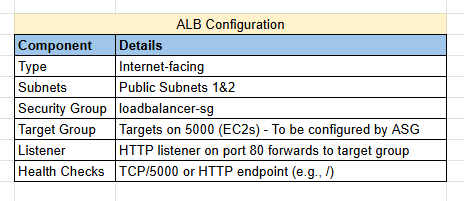

# Application Load Balancer Configuration

[← Back to project README](../README.md)

## 1. Target group

| Setting | Value |
| :--- | :--- |
| Target type | Instances |
| Name | `ritual-roast-app-tg` |
| Protocol : port | HTTP : `5000` |
| VPC | `ritual-roast-vpc` |
| Health check | Healthy threshold 3, interval 10 s |

Targets are not registered manually – the Auto Scaling Group registers and deregisters instances automatically.

## 2. Load balancer

| Setting | Value |
| :--- | :--- |
| Type | Application Load Balancer (internet-facing) |
| Name | `ritual-roast-app-alb` |
| VPC | `ritual-roast-vpc` |
| Subnets | `PublicSubnet-01-2a` (eu-west-2a), `PublicSubnet-02-2b` (eu-west-2b) |
| Security group | `LoadBalancer-SG` |
| Listener | HTTP : 80 → `ritual-roast-app-tg` |
