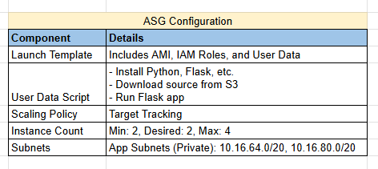
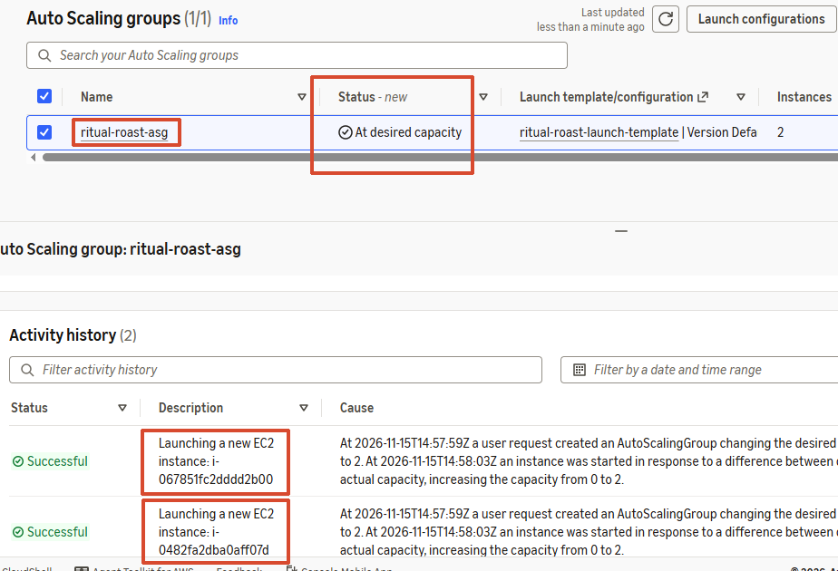

# Launch Template & Auto Scaling Group Configuration

[← Back to project README](../README.md)

## 1. Launch template

| Setting | Value |
| :--- | :--- |
| Name | `ritual-roast-launch-template` |
| AMI | Amazon Linux (Quick Start) |
| Instance type | `t2.micro` |
| Key pair | None (access through Session Manager) |
| Security group | `Web-App-SG` |
| IAM instance profile | `ritual-roast-master-ec2-iam-role` |
| User data | [`app/user-data.sh`](../app/user-data.sh) |

### What the user-data script does

1. Installs `python3-pip` (and the AWS CLI if it is missing).
2. Runs `aws s3 sync s3://rr-1-source-code /home/ec2-user/myflaskapp --region eu-west-2`.
3. Installs the Python dependencies from `requirements.txt`.
4. Starts the Flask app in the background with `nohup` on port **5000** and logs to `/var/log/flask-app.log`.

## 2. Auto Scaling Group

| Setting | Value |
| :--- | :--- |
| Name | `ritual-roast-asg` |
| Launch template | `ritual-roast-launch-template` |
| VPC | `ritual-roast-vpc` |
| Subnets | `WebSubnet-01-2a`, `WebSubnet-02-2b` (private) |
| Load balancing | Attached to target group `ritual-roast-app-tg` |
| Health checks | Elastic Load Balancing health checks **on** |
| Capacity | Desired **2** · Min **2** · Max **2** |
| Instance name tag | `rr-srvrs` |

The activity history in the screenshot shows the ASG launching two new instances in response to the desired capacity of 2, reaching the **At desired capacity** state.

> The design diagram allows scaling to a maximum of 4 instances with a target-tracking policy; the lab deployment was pinned at 2 to control cost.
