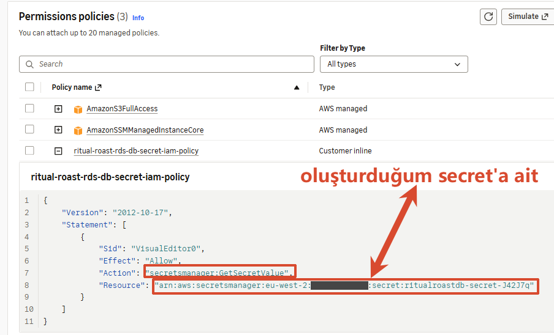
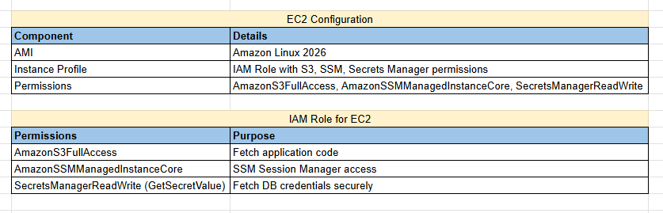

# IAM Role for EC2

[← Back to project README](../README.md)

EC2 instances in the Auto Scaling Group use an **instance profile** so no access keys ever live on the servers.

| Setting | Value |
| :--- | :--- |
| Trusted entity | AWS service → EC2 |
| Use case | EC2 Role for AWS Systems Manager |
| Role name | `ritual-roast-master-ec2-iam-role` |

| Permission | Type | Purpose |
| :--- | :--- | :--- |
| `AmazonSSMManagedInstanceCore` | AWS managed | Shell access through Session Manager (no SSH, no bastion, no key pair) |
| `AmazonS3FullAccess` | AWS managed | Download the application code from the S3 bucket |
| Inline policy → `secretsmanager:GetSecretValue` | Customer inline | Read **only** the database secret (scoped to its ARN) |

> **Hardening note:** `AmazonS3FullAccess` is broader than needed for a lab. A least-privilege policy would allow only `s3:GetObject` / `s3:ListBucket` on `rr-1-source-code`.
