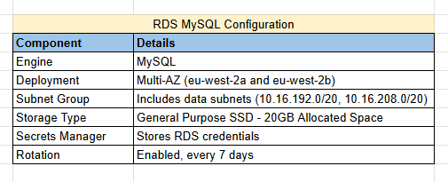
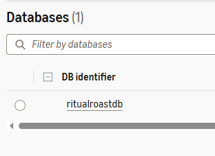
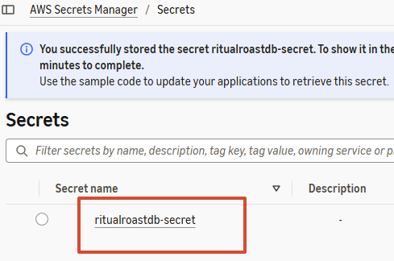

# RDS MySQL & Secrets Manager Configuration

[← Back to project README](../README.md)

## 1. DB subnet group

| Setting | Value |
| :--- | :--- |
| Name | `ritual-roast-rds-subnet-group` |
| VPC | `ritual-roast-vpc` |
| Availability Zones | `eu-west-2a`, `eu-west-2b` |
| Subnets | `DataSubnet-01-2a`, `DataSubnet-02-2b` |

## 2. Database instance

| Setting | Value |
| :--- | :--- |
| Creation method | Standard create |
| Engine | MySQL |
| Deployment | **Multi-AZ DB instance** (primary + standby) |
| DB instance identifier | `ritualroastdb` |
| Initial database name | `ritualroastdb` |
| Instance class | Burstable – `db.t3.micro` |
| Storage | 20 GiB General Purpose SSD, storage autoscaling **off** |
| VPC / security group | `ritual-roast-vpc` / `Database-SG` |
| Credentials | Self-managed master user (strong password – never committed to source control) |
| Backup retention | 1 day |

## 3. Secret with automatic rotation

| Setting | Value |
| :--- | :--- |
| Secret type | Credentials for Amazon RDS database |
| Database | `ritualroastdb` |
| Secret name | `ritualroastdb-secret` |
| Automatic rotation | Enabled – every **7 days** |
| Rotation function | `SecretsManager-ritualroast-secret-rotation` (Lambda created by Secrets Manager) |

The Flask application never stores database credentials. At start-up – and again whenever a connection is lost (e.g. after a rotation) – it calls `GetSecretValue` and reads `host`, `username`, `password`, `dbname` and `port` from the secret.
