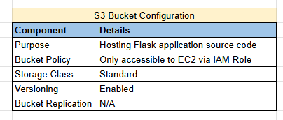
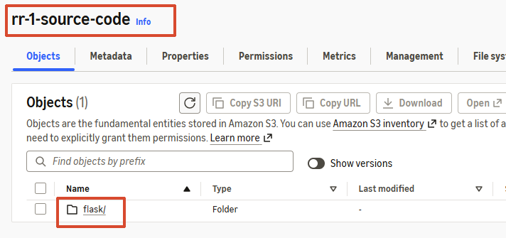

# S3 Bucket Configuration

[← Back to project README](../README.md)

The S3 bucket is the **delivery mechanism for the application code**: the build artefacts are uploaded once, and every EC2 instance launched by the Auto Scaling Group pulls them at boot (see [`user-data.sh`](../app/user-data.sh)).

| Setting | Value |
| :--- | :--- |
| Bucket name | `rr-1-source-code` |
| Purpose | Hosting the Flask application source code |
| Access | Private – readable only by EC2 through its IAM role |
| Versioning | Enabled |
| Storage class | Standard |

**What is uploaded:** the whole [`app/flask`](../app/flask) folder (Flask API + compiled React build).
