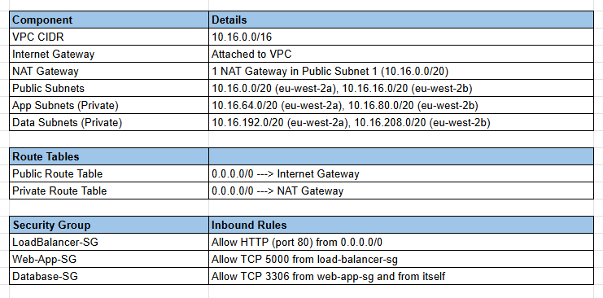
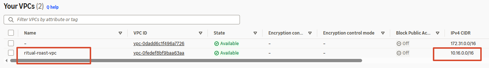
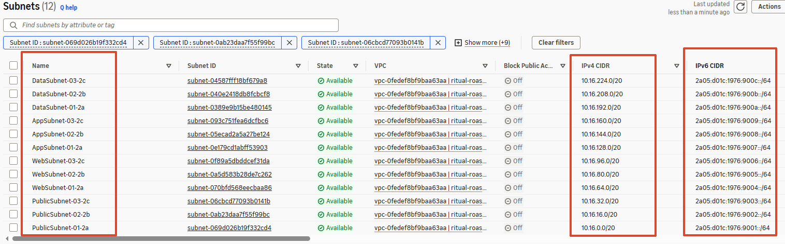
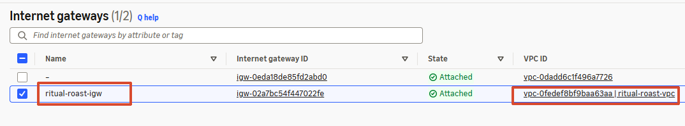
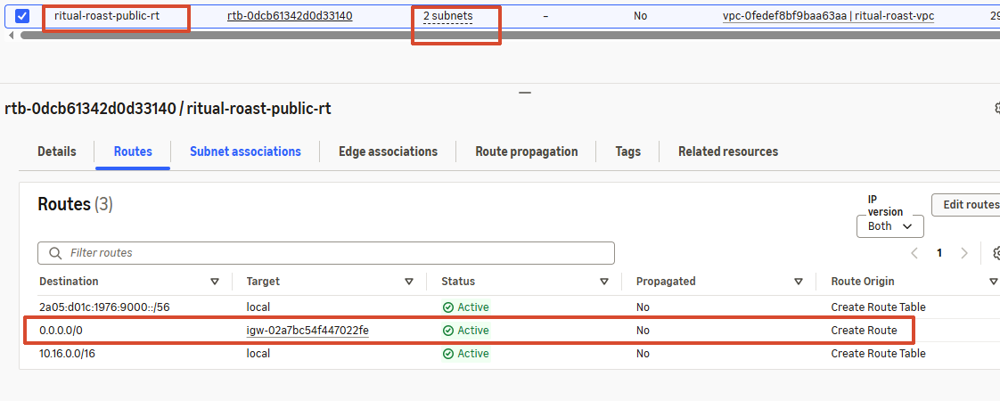
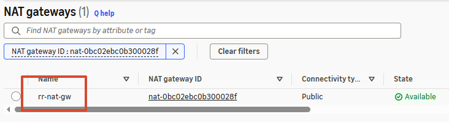
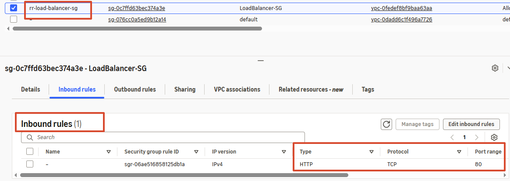
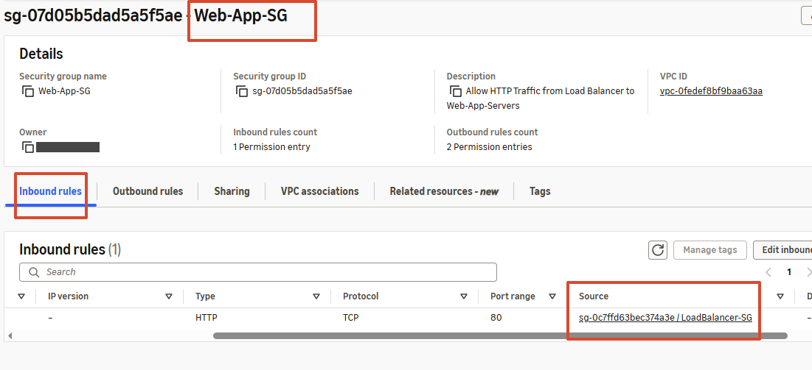
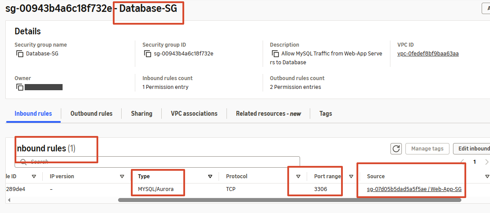

# VPC Configuration

[← Back to project README](../README.md)

All resources were created in the **London (`eu-west-2`)** region inside a custom VPC. The network is organised in four layers (public / web / app / data) spread over multiple Availability Zones.

**Build order:** VPC → Subnets → Internet Gateway → Route Tables → NAT Gateway → Security Groups



## 1. Custom VPC



| Setting | Value |
| :--- | :--- |
| VPC settings | VPC only |
| Name | `ritual-roast-vpc` |
| IPv4 CIDR | `10.16.0.0/16` |
| IPv6 CIDR | Amazon-provided IPv6 CIDR block |
| Tenancy | Default |
| Tag | `Project: ritual-roast-webapp` |

> Under *DNS settings*, **Enable DNS hostnames** is turned on.

## 2. Subnets



Subnets were created for three Availability Zones; only **2a** and **2b** are used by the application.

| Tier | Subnet | IPv4 CIDR | AZ |
| :--- | :--- | :--- | :--- |
| Public (DMZ) | `PublicSubnet-01-2a` | `10.16.0.0/20` | `eu-west-2a` |
| Public (DMZ) | `PublicSubnet-02-2b` | `10.16.16.0/20` | `eu-west-2b` |
| Public (DMZ) | `PublicSubnet-03-2c` | `10.16.32.0/20` | `eu-west-2c` |
| Web / App | `WebSubnet-01-2a` | `10.16.64.0/20` | `eu-west-2a` |
| Web / App | `WebSubnet-02-2b` | `10.16.80.0/20` | `eu-west-2b` |
| Web / App | `WebSubnet-03-2c` | `10.16.96.0/20` | `eu-west-2c` |
| App (reserved) | `AppSubnet-01-2a` | `10.16.128.0/20` | `eu-west-2a` |
| App (reserved) | `AppSubnet-02-2b` | `10.16.144.0/20` | `eu-west-2b` |
| App (reserved) | `AppSubnet-03-2c` | `10.16.160.0/20` | `eu-west-2c` |
| Data | `DataSubnet-01-2a` | `10.16.192.0/20` | `eu-west-2a` |
| Data | `DataSubnet-02-2b` | `10.16.208.0/20` | `eu-west-2b` |
| Data | `DataSubnet-03-2c` | `10.16.224.0/20` | `eu-west-2c` |

Each subnet also received an IPv6 /64 block. Because the frontend and backend run together on the same instances in this iteration, the EC2 instances are placed in the **Web** subnets; the **App** subnets are provisioned for a future dedicated application tier.

Auto-assign settings:

- Public subnets 2a/2b → **auto-assign public IPv4**
- Web and Data subnets 2a/2b → **auto-assign IPv6**

## 3. Internet Gateway



| Setting | Value |
| :--- | :--- |
| Name | `ritual-roast-igw` |
| Attached to | `ritual-roast-vpc` |

## 4. Route tables



| Route table | Route | Associated subnets |
| :--- | :--- | :--- |
| `ritual-roast-public-rt` | `0.0.0.0/0` → Internet Gateway (`ritual-roast-igw`) | `PublicSubnet-01-2a`, `PublicSubnet-02-2b` |
| `ritual-roast-main-rt` (VPC main route table) | `0.0.0.0/0` → NAT Gateway (`rr-nat-gw`) | all other subnets (implicit) |

Private subnets therefore reach the internet only **outbound** through the NAT gateway (for package installs, S3 and Secrets Manager calls).

## 5. NAT Gateway



| Setting | Value |
| :--- | :--- |
| Name | `rr-nat-gw` |
| Subnet | `PublicSubnet-01-2a` |
| Connectivity | Public, with an allocated Elastic IP |

## 6–8. Security groups (chained)

Traffic is only allowed **from the previous tier**, never directly from the internet:

```text
Internet ──80──▶ LoadBalancer-SG ──5000──▶ Web-App-SG ──3306──▶ Database-SG
```

### Load balancer security group



| Setting | Value |
| :--- | :--- |
| Name | `LoadBalancer-SG` |
| Inbound | HTTP · TCP 80 · `0.0.0.0/0` |

### Web / app security group



| Setting | Value |
| :--- | :--- |
| Name | `Web-App-SG` |
| Inbound | Custom TCP · 5000 · source `LoadBalancer-SG` |

### Database security group



| Setting | Value |
| :--- | :--- |
| Name | `Database-SG` |
| Inbound #1 | MySQL/Aurora · TCP 3306 · source `Web-App-SG` |
| Inbound #2 | MySQL/Aurora · TCP 3306 · source `Database-SG` (itself) |

> The self-referencing rule is required because Secrets Manager's rotation Lambda is deployed into the database subnets and attaches itself to the same security group as the database.
