# Project 2 — Containerized Deployment on Amazon ECS Fargate

> **Stage 2 of 3** · The same application, re-platformed: the monolith is split into a **Next.js frontend** and a **Flask API**, each packaged as a Docker image and run as an independent ECS service on **AWS Fargate** — no EC2 instances to manage.

[← Main README](../README.md) · [← Project 1](../01-three-tier-ec2/README.md) · [Project 3 — Serverless →](../03-serverless/README.md)


---

## 1. What changed compared to Project 1

| | Project 1 | **Project 2** |
| :--- | :--- | :--- |
| Frontend | React build served by Flask | **Next.js 15** (React 19, Tailwind, Bootstrap) in its own container |
| Backend | Flask (same process as frontend) | **Flask API** in its own container |
| Compute | EC2 + Auto Scaling Group | **ECS on Fargate** (serverless containers) |
| Routing | One target group | **Path-based routing** on the ALB: `/api/*` → Flask, everything else → Next.js |
| Scaling unit | The whole app | **Each service scales independently** |
| Deployment | Sync code to S3, reboot instances | Build image → push to **ECR** → update ECS service |

**Goal:** eliminate server management (patching, AMIs, SSH, user data) while keeping the proven VPC / RDS / Secrets Manager foundation from Project 1.

---

## 2. Choosing the platform

**ECS with Fargate** was chosen: fully managed compute, a custom container for Next.js, independent scaling per service, and it keeps the relational database. The middle column (Amplify + Lambda + API Gateway + DynamoDB) was equally "managed" – and became [Project 3](../03-serverless/README.md).

---

## 3. Architecture

### Customer flow

<table>
  <tr>
    <td width="50%">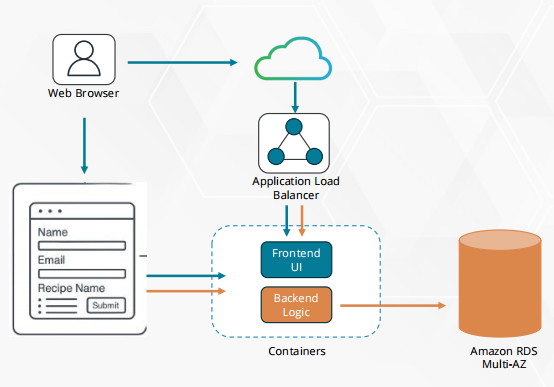</td>
    <td width="50%" valign="top">

1. The user opens the site over the public internet.
2. The **Application Load Balancer** applies **path-based routing**: requests to `/api/*` go to the Flask target group, all other requests go to the Next.js target group.
3. **ECS Fargate** runs the Next.js frontend and the Flask backend as two independent services, so they scale and deploy separately.
4. **Amazon RDS for MySQL** stores the recipes; the backend reads credentials from **Secrets Manager**.

    </td>
  </tr>
</table>

### High-level design

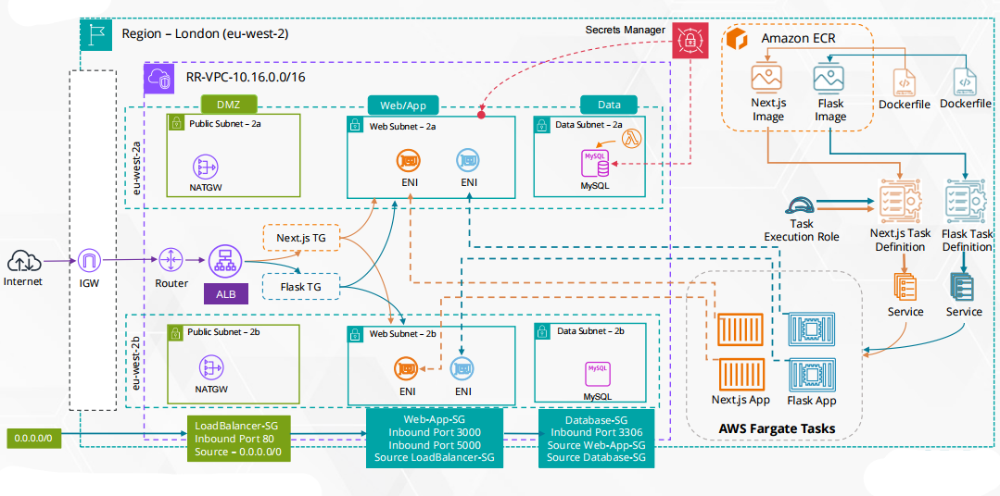

### How a request travels

```text
Browser ──▶ ALB :80
             ├─ path /api/*  ──▶ ritual-roast-flask-tg  (:5000) ──▶ Flask tasks  ──▶ RDS MySQL
             └─ default      ──▶ ritual-roast-nextjs-tg (:3000) ──▶ Next.js tasks
```

Because the browser calls the API with relative URLs (`/api/get_recipe`, `/api/add_recipe`), frontend and backend share one origin through the ALB — the frontend needs no hard-coded backend address.

---

## 4. Low-level design — configuration summary

<details>
<summary><b>VPC, subnets, route tables and security groups</b></summary>

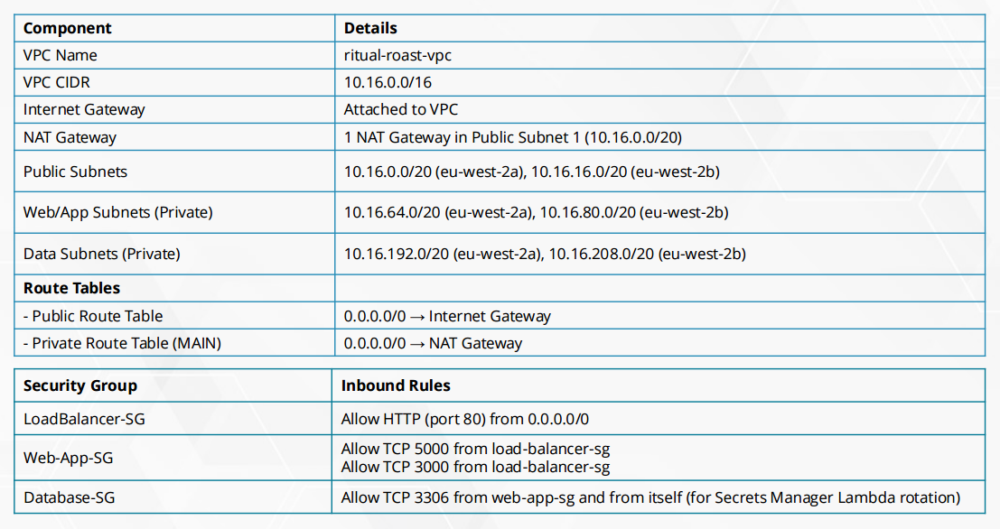

</details>

<details>
<summary><b>RDS MySQL</b></summary>

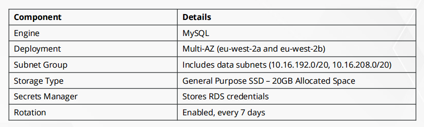

</details>

<details>
<summary><b>IAM roles (ECS task execution + Docker build server)</b></summary>

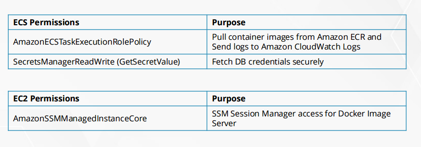

</details>

<details>
<summary><b>Docker build server, ECR, task definitions</b></summary>

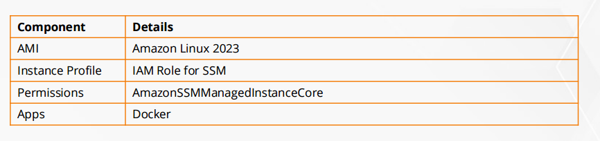
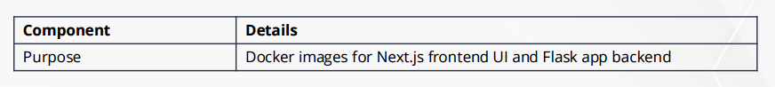
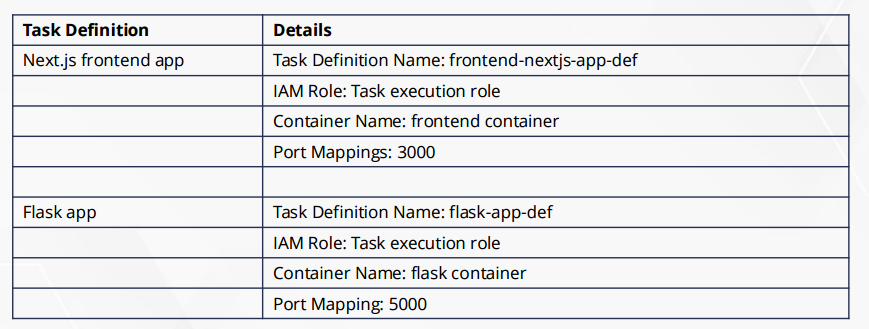

</details>

<details>
<summary><b>Target groups, ALB and ECS services</b></summary>

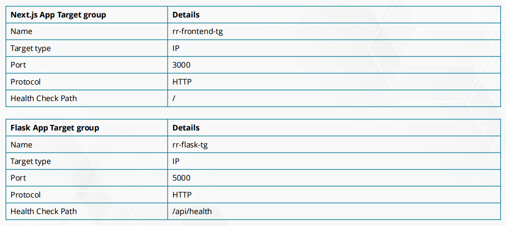
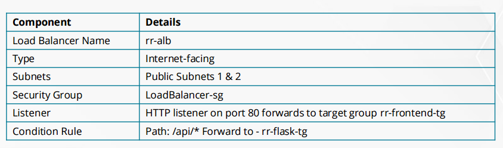
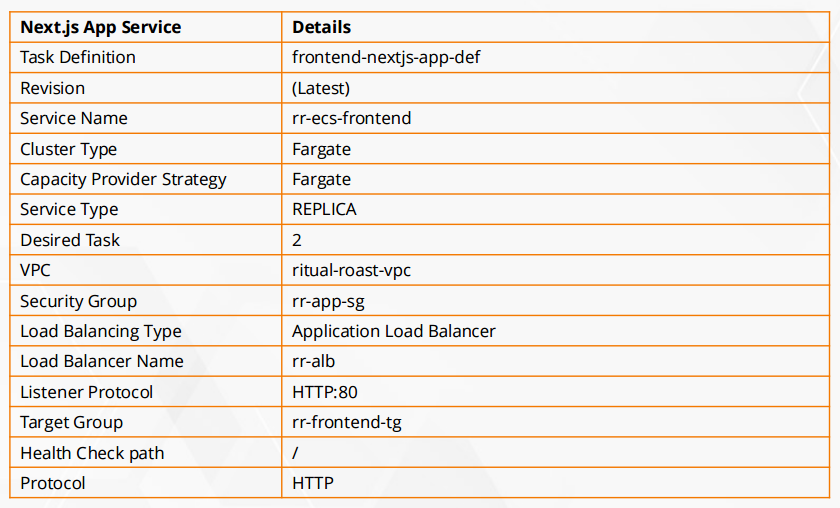
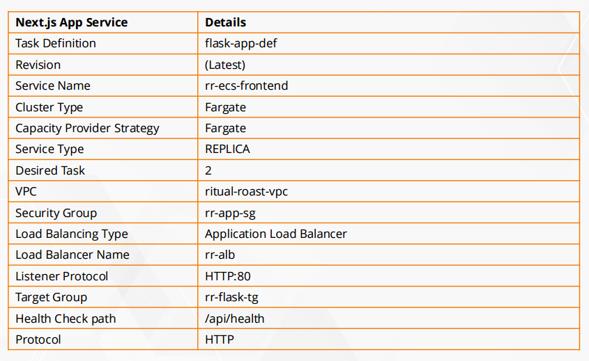

</details>

---

## 5. Implementation walkthrough

### Step 1 — Network foundation

The VPC, subnets, route tables and security groups follow the design from [Project 1](../01-three-tier-ec2/docs/vpc-configuration.md), with these changes:

- A **NAT Gateway** (`rr-nat-gw`, in `PublicSubnet-01-2a`) is created first, and the main route table sends `0.0.0.0/0` to it so private Fargate tasks can pull images from ECR and call Secrets Manager.

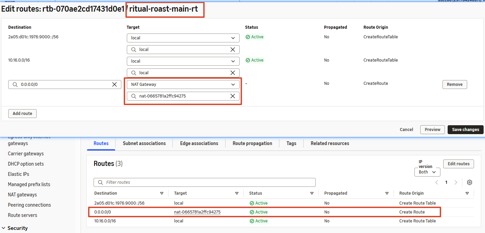

- `Web-App-SG` now accepts traffic from `LoadBalancer-SG` on **two ports**: `5000` (Flask) and `3000` (Next.js).

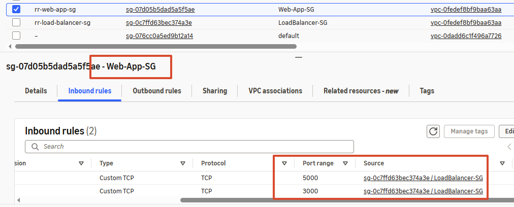

- `Database-SG` allows `3306` from `Web-App-SG` **and from itself**. The self-reference is needed because Secrets Manager rotation deploys a Lambda function into the database subnets that attaches to the same security group.

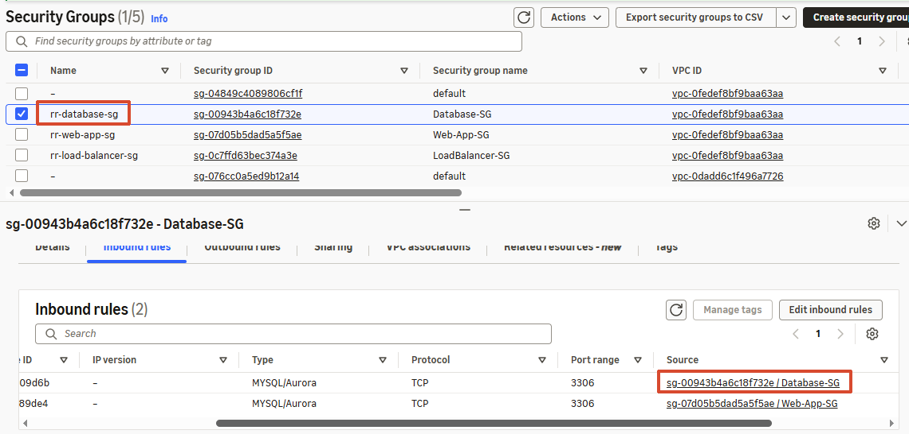

### Step 2 — Database and secret

| Setting | Value |
| :--- | :--- |
| Engine / class | MySQL · `db.t3.micro` |
| Identifier / initial DB | `recipedb` |
| Storage | 20 GiB, autoscaling off |
| Subnets / SG | Data subnets · `Database-SG` |
| Deployment (lab) | Single-AZ in `eu-west-2a` to save cost (the design calls for Multi-AZ) |
| Secret | `rr-recipe-secret` (RDS credentials) with **automatic rotation every 7 days** |

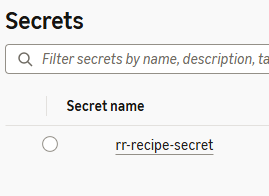

### Step 3 — IAM roles

| Role | Policies | Purpose |
| :--- | :--- | :--- |
| `ritual-roast-ecs-task-execution-role` | `AmazonECSTaskExecutionRolePolicy` + inline `secretsmanager:GetSecretValue` scoped to `rr-recipe-secret` | Pull images from ECR, write logs, let the Flask container read DB credentials |
| `ritual-roast-docker-ec2-role` | `AmazonSSMManagedInstanceCore` + `EC2InstanceProfileForImageBuilderECRContainerBuilds` (ECR push) | Session Manager access and image upload from the temporary Docker server |

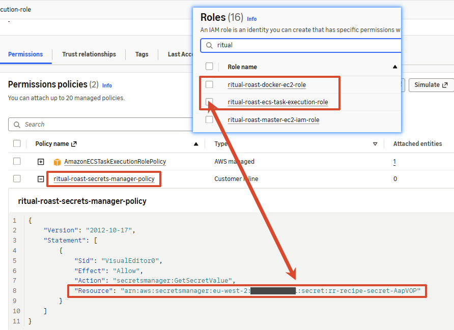

### Step 4 — Build and push Docker images

A temporary EC2 instance (Amazon Linux 2023 with Docker, accessed through Session Manager) was used to build the two images and push them to **Amazon ECR**.

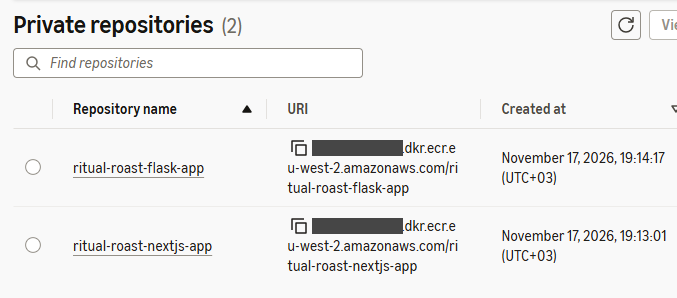

The Docker server's role needed an additional permission to obtain an ECR authorization token:

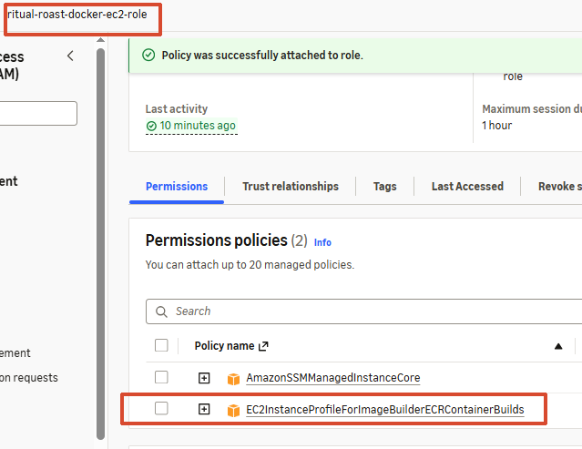

```bash
# authenticate Docker to ECR
aws ecr get-login-password --region eu-west-2 | \
  docker login --username AWS --password-stdin <account-id>.dkr.ecr.eu-west-2.amazonaws.com

# frontend
docker build -t ritual-roast-nextjs-app ./frontend
docker tag  ritual-roast-nextjs-app:latest <account-id>.dkr.ecr.eu-west-2.amazonaws.com/ritual-roast-nextjs-app:latest
docker push <account-id>.dkr.ecr.eu-west-2.amazonaws.com/ritual-roast-nextjs-app:latest

# backend
docker build -t ritual-roast-flask-app ./backend
docker tag  ritual-roast-flask-app:latest <account-id>.dkr.ecr.eu-west-2.amazonaws.com/ritual-roast-flask-app:latest
docker push <account-id>.dkr.ecr.eu-west-2.amazonaws.com/ritual-roast-flask-app:latest
```

<table>
  <tr>
    <td width="50%">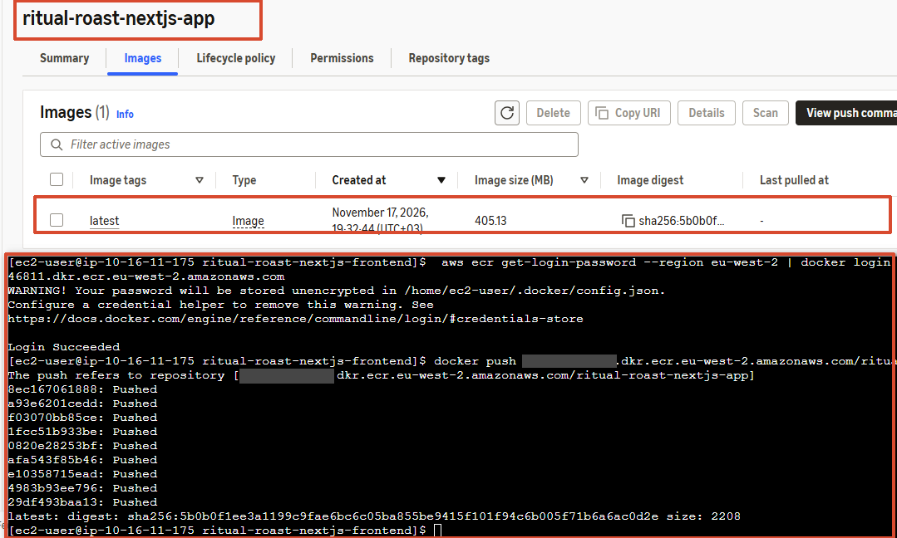<br><sub>Frontend image pushed (≈405 MB)</sub></td>
    <td width="50%">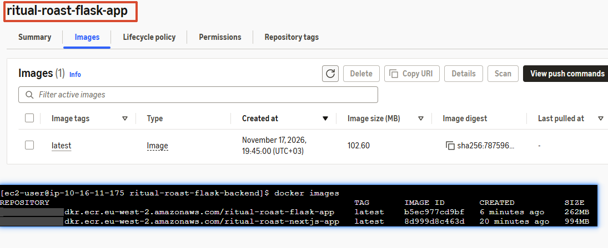<br><sub>Backend image pushed (≈103 MB)</sub></td>
  </tr>
</table>

### Step 5 — Target groups and Application Load Balancer

Two **IP-type** target groups (required for Fargate's `awsvpc` networking):

| Target group | Port | Health check |
| :--- | :--- | :--- |
| `ritual-roast-flask-tg` | `5000` | `/api/health` |
| `ritual-roast-nextjs-tg` | `3000` | `/` |

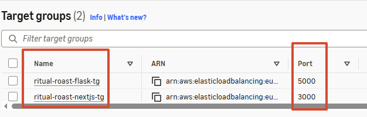

The internet-facing ALB (`ritual-roast-alb`, public subnets, `LoadBalancer-SG`) listens on **HTTP:80**. The **default action** forwards to the Next.js target group, and a **listener rule** sends `Path = /api/*` to the Flask target group.

<table>
  <tr>
    <td width="50%">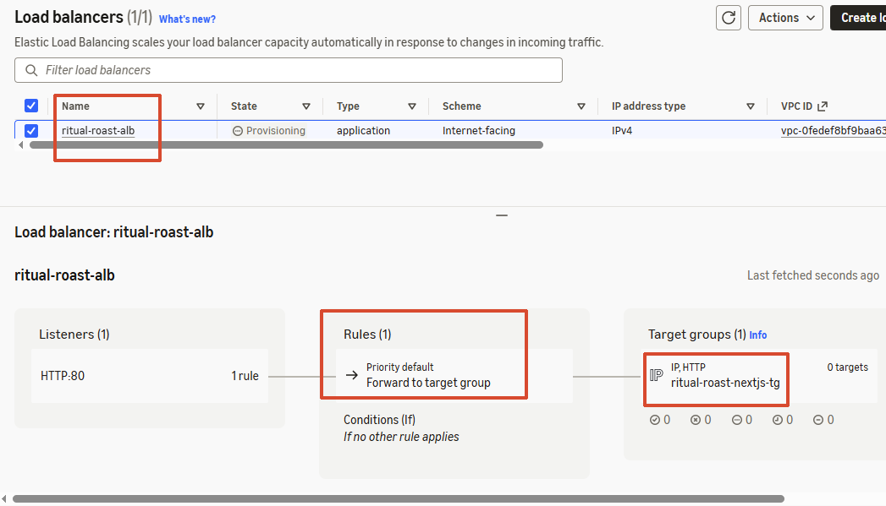</td>
    <td width="50%">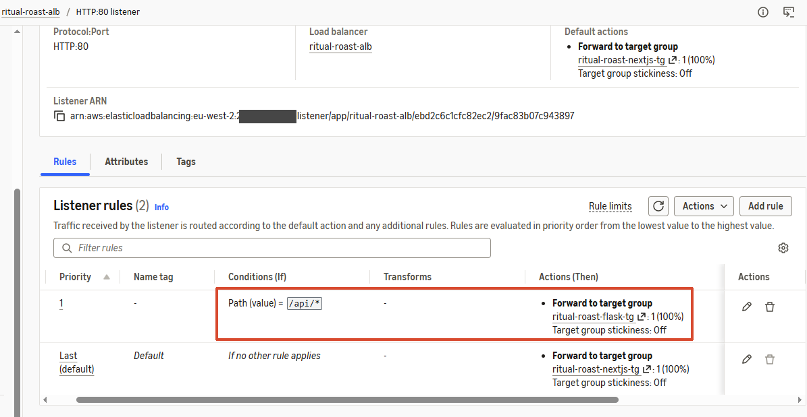</td>
  </tr>
</table>

### Step 6 — Task definitions, cluster and services

- **Task definitions** (Fargate): `ritual-roast-nextjs-task-def` (container port 3000) and `ritual-roast-flask-task-def` (container port 5000), each pointing to its ECR image and using the execution role.
- **Cluster:** `ritual-roast-webapp-cluster`.
- **Services:** one per task definition — replica scheduling, **2 desired tasks** each, placed in the private Web subnets across two AZs with **public IP disabled**, attached to the matching target group.

<table>
  <tr>
    <td width="33%">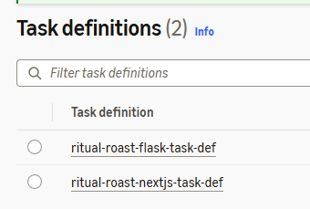</td>
    <td width="33%">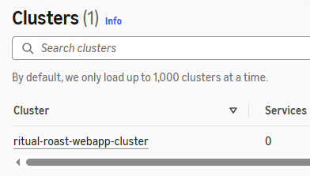</td>
    <td width="33%">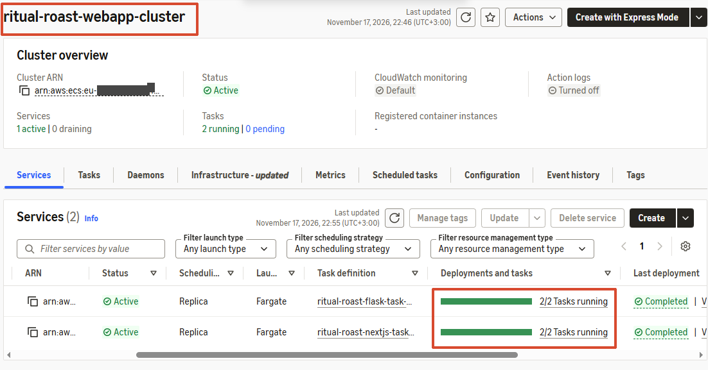</td>
  </tr>
</table>

Fargate injects an **ENI** for each task into the chosen subnets. The ALB resource map confirms the routing and that all four targets are healthy — two Flask tasks on `:5000` and two Next.js tasks on `:3000`:

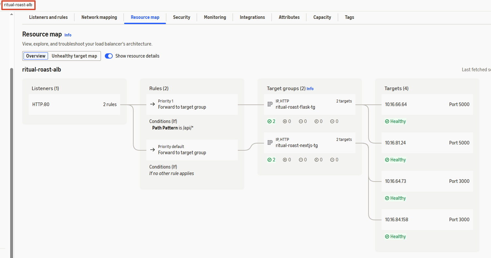

---

## 6. Result

<table>
  <tr>
    <td width="50%"><br><sub>Home page served by the Next.js service</sub></td>
    <td width="50%">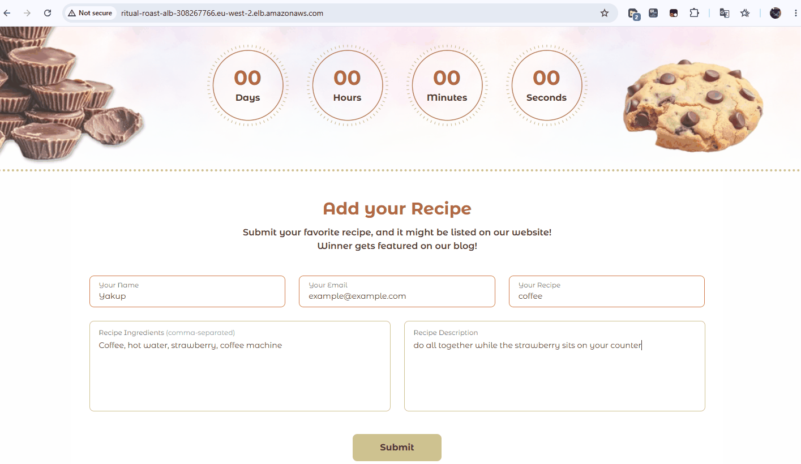<br><sub>Submitting a recipe → <code>/api/add_recipe</code> → Flask → RDS</sub></td>
  </tr>
  <tr>
    <td width="50%">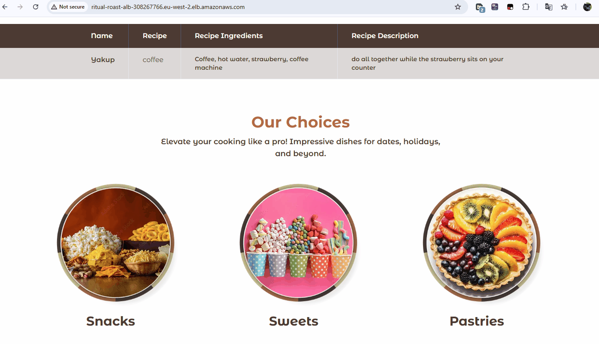<br><sub>Recipe listed from <code>/api/get_recipe</code></sub></td>
    <td width="50%">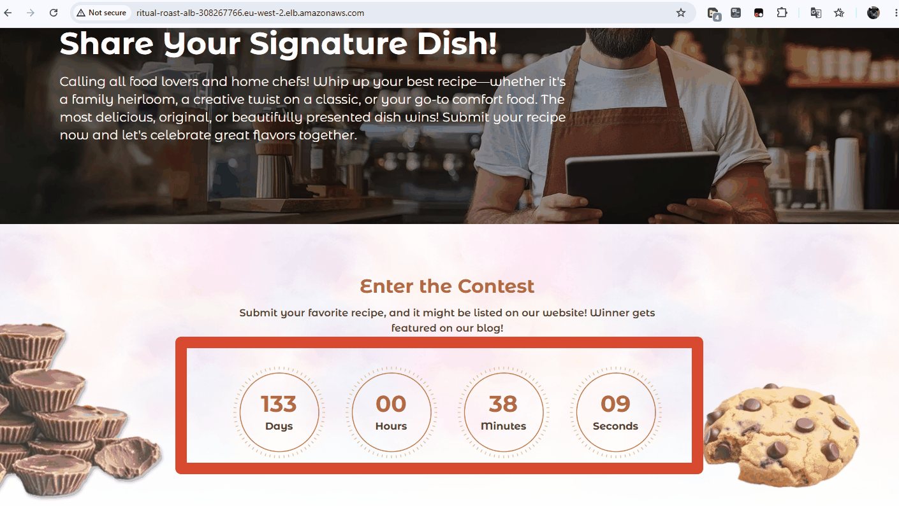<br><sub>Countdown fixed after redeploy</sub></td>
  </tr>
</table>

### A real-world redeploy

After the first deployment, the countdown timer showed `00 : 00 : 00 : 00` because its target date was already in the past. The fix exercised the full container release loop:

> **fix the code → rebuild the Docker image → push to ECR → update the ECS service**

No servers were touched; ECS replaced the running tasks with ones built from the new image.

---

## 7. Source code

| Path | Description |
| :--- | :--- |
| [`frontend/`](frontend) | Next.js 15 / React 19 / TypeScript app. `Dockerfile` (Node 20 Alpine) runs `npm run build` then `npm start` on port 3000 |
| [`backend/app.py`](backend/app.py) | Flask API: `GET /api/get_recipe`, `POST /api/add_recipe`, `GET /api/health` |
| [`backend/Dockerfile`](backend/Dockerfile) | `python:3.11-slim`, installs dependencies, runs `flask run` on port 5000 |

**Backend configuration** (environment variables, with the values used in this project as defaults):

| Variable | Default | Meaning |
| :--- | :--- | :--- |
| `AWS_REGION` | `eu-west-2` | Region of the secret |
| `DB_SECRET_ID` | `rr-recipe-secret` | Secrets Manager secret holding the DB credentials |

Database credentials are **never** in the image or the task definition — the container reads them from Secrets Manager at start-up using its task role.

**Run the frontend locally**

```bash
cd frontend
npm install
npm run dev        # http://localhost:3000  (API calls go to /api/*, so run the backend behind a proxy or the ALB)
```

---

## 8. Clean-up

Delete in this order to stop charges: ECS services (set desired count to 0) → ECS cluster → task definitions (deregister) → ECR repositories and images → secret → RDS instance → NAT Gateway (+ release the Elastic IP) → load balancer and target groups → temporary Docker EC2 instance.
