# Project 3 — Fully Serverless Architecture

> **Stage 3 of 3** · The application re-architected with cloud-native services: a static site on **S3 + CloudFront**, an API on **API Gateway + Lambda**, and a **DynamoDB** table. No VPC, no servers, no containers, nothing to patch or monitor — and you pay only for what is used.

[← Main README](../README.md) · [← Project 2](../02-containerized-ecs-fargate/README.md)


---

## 1. Why re-architect?

AWS describes seven common migration strategies, the **7 Rs**:

| Strategy | Meaning |
| :--- | :--- |
| Retire | Turn off what you no longer need |
| Retain | Keep as is, revisit later |
| Rehost | "Lift and shift" |
| Relocate | Move whole environments as they are |
| Repurchase | Move to a different product (e.g. SaaS) |
| Replatform | "Lift, tinker and shift" |
| **Refactor / Re-architect** | **Re-imagine the application with cloud-native services** |

Project 1 was essentially a *rehost* of a traditional design; Project 2 was a *replatform* to containers. **Project 3 is a full refactor.**

The business drivers for this iteration:

- The frontend is now plain **HTML, CSS and JavaScript** — no server-side rendering needed.
- No appetite for container orchestration or relational database management.
- No need to run or monitor a VPC network (and its flow logs).
- Lower latency for visitors → caching and global distribution.
- "Make it cheaper" → pay-per-use pricing.
- "We don't want to monitor anything" → fully managed services.

### Requirements → AWS services

| Requirement | Solution |
| :--- | :--- |
| Frontend is a static website | **Amazon S3** |
| Backend logic (Python) without a VPC | **AWS Lambda** — `AddRecipe` and `GetRecipe` functions |
| Alternative to RDS | **Amazon DynamoDB** |
| Route incoming requests to backend logic | **Amazon API Gateway** (REST API) |
| Low latency, caching, global distribution | **Amazon CloudFront** |
| Reduce cost | Pay-per-request services + **AWS Cost Explorer** to track it |

---

## 2. Architecture

### Customer flow

<table>
  <tr>
    <td width="50%">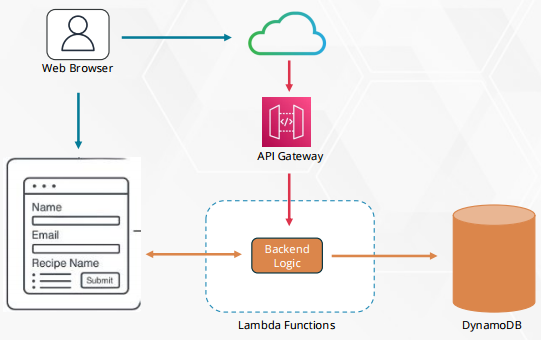</td>
    <td width="50%" valign="top">

1. The user opens the site through the **CloudFront** distribution (served from the nearest edge location).
2. CloudFront fetches the static files (HTML, JS, images) from the **S3** bucket.
3. The page's JavaScript calls **API Gateway**, which accepts `GET` and `POST` requests and invokes the matching Lambda function.
4. **Lambda** `AddRecipe` writes a recipe to DynamoDB; `GetRecipe` reads the recipes back.
5. **DynamoDB** stores the data — a managed NoSQL database with on-demand capacity.

    </td>
  </tr>
</table>

### High-level design

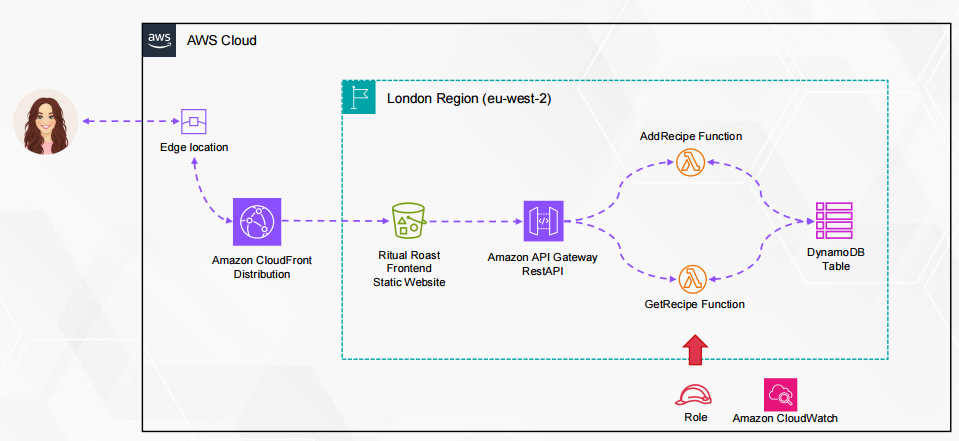

```text
                     static files                     REST calls
Browser ─▶ CloudFront ───────────▶ S3 bucket
   │
   └──────────────▶ API Gateway ─┬─ POST ─▶ Lambda AddRecipe ─┐
                                 └─ GET  ─▶ Lambda GetRecipe ─┴─▶ DynamoDB (recipes)
                                            (logs → CloudWatch)
```

---

## 3. Low-level design — configuration summary

<details>
<summary><b>DynamoDB · IAM · Lambda</b></summary>

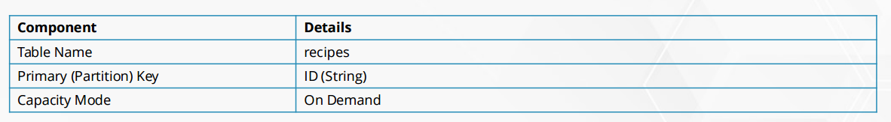
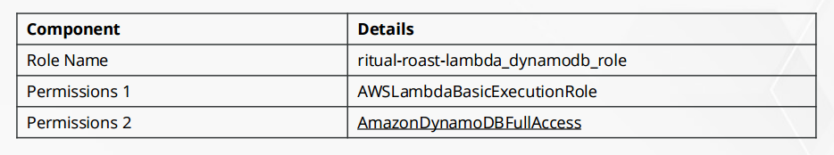
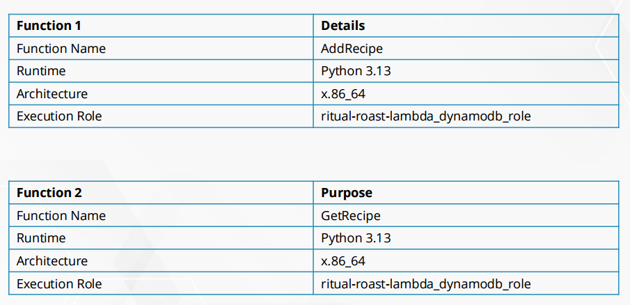

</details>

<details>
<summary><b>API Gateway · S3 · CloudFront</b></summary>

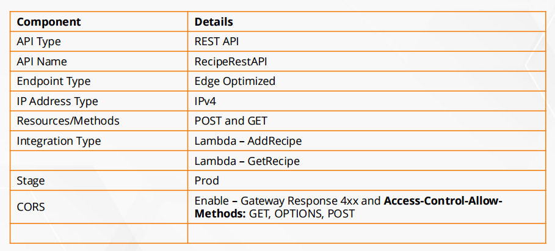
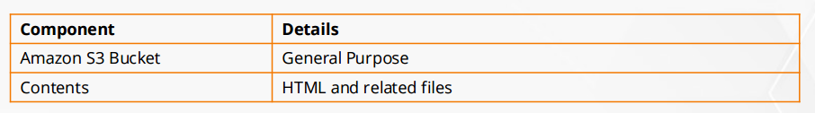
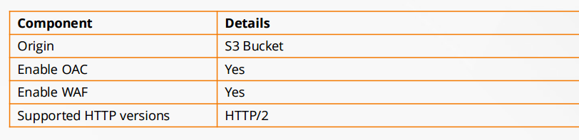

</details>

---

## 4. Implementation walkthrough

Resources were built **bottom-up** (data → logic → API → frontend → CDN) so each layer could reference the one below it.

### Step 1 — IAM role for Lambda

| Setting | Value |
| :--- | :--- |
| Role name | `ritual-roast-lambda-dynamodb-access` |
| Policies | `AWSLambdaBasicExecutionRole` (CloudWatch Logs) and `AmazonDynamoDBFullAccess` |

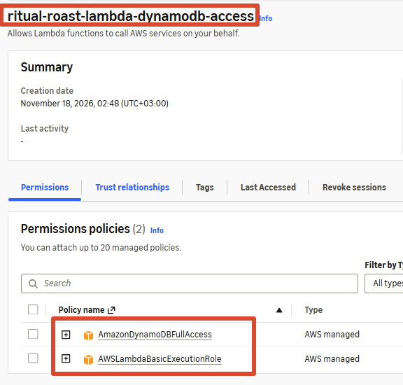

### Step 2 — DynamoDB table

| Setting | Value |
| :--- | :--- |
| Table name | `recipes` |
| Partition key | `id` (String) |
| Capacity mode | **On-demand** (pay per request, no capacity planning) |

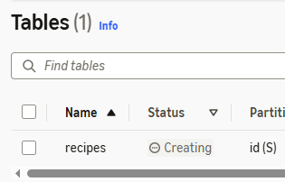

### Step 3 — Lambda functions

Two small Python 3.13 functions (x86_64) sharing the role above — source in [`backend/`](backend):

| Function | Source | What it does |
| :--- | :--- | :--- |
| `AddRecipe` | [`backend/AddRecipe.py`](backend/AddRecipe.py) | Parses the request body, generates a UUID, stores `name`, `email`, `recipe_name`, `description_main`, `ingredients` and a UTC `created_at` timestamp, returns `200` with the new `recipe_id` |
| `GetRecipe` | [`backend/GetRecipe.py`](backend/GetRecipe.py) | Scans the table and returns each recipe's name, title, ingredients and description. The email address is deliberately **not** returned |

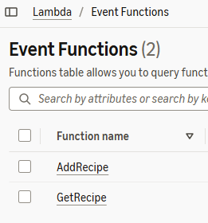

### Step 4 — API Gateway

| Setting | Value |
| :--- | :--- |
| API | REST API `RecipeRestAPI` (edge-optimized, IPv4) |
| Methods on `/` | `POST` → Lambda `AddRecipe` · `GET` → Lambda `GetRecipe` · `OPTIONS` → mock integration (CORS pre-flight) |
| CORS | Enabled, with `GET, OPTIONS, POST` allowed and gateway 4xx responses included |
| Stage | `prod` |

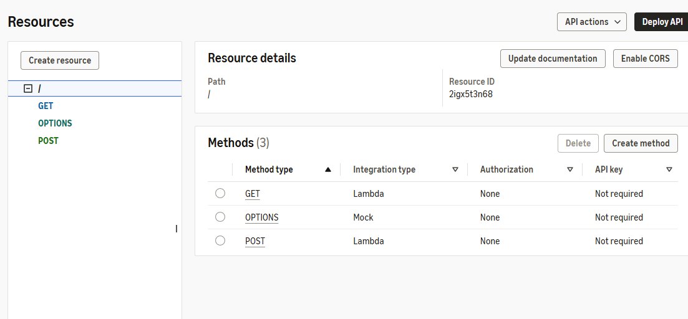

### Step 5 — S3 bucket for the frontend

The static site ([`frontend/`](frontend): `index.html`, `recipe_api.js`, `images/`) is uploaded to a general-purpose bucket, `ritual-roast-serverless-bucket`.

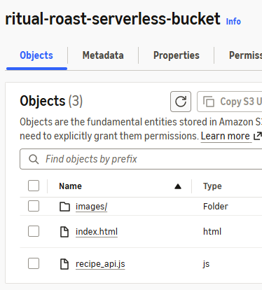

> Before uploading, set the `API_URL` constant at the top of [`frontend/recipe_api.js`](frontend/recipe_api.js) to your API Gateway **invoke URL** (`https://<api-id>.execute-api.eu-west-2.amazonaws.com/prod`).

### Step 6 — CloudFront distribution

| Setting | Value |
| :--- | :--- |
| Origin | The S3 bucket |
| Origin access | **Origin Access Control (OAC)** — the bucket stays private and is reachable only through CloudFront |
| AWS WAF | Enabled |
| HTTP versions | HTTP/2 (and HTTP/1.1, HTTP/1.0) |
| Price class | Use all edge locations (best performance) |

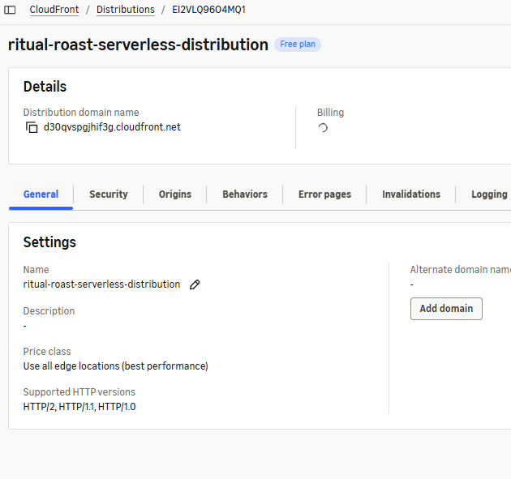

---

## 5. Result

<table>
  <tr>
    <td width="33%">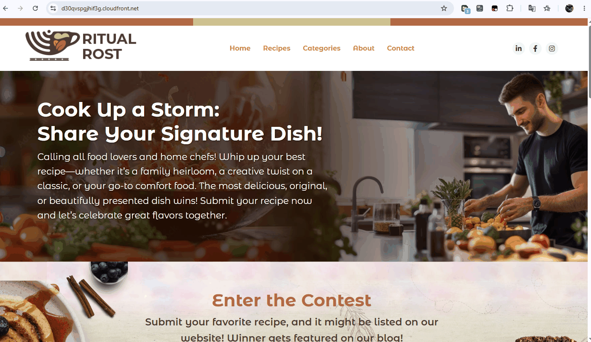<br><sub>Home page delivered by CloudFront</sub></td>
    <td width="33%">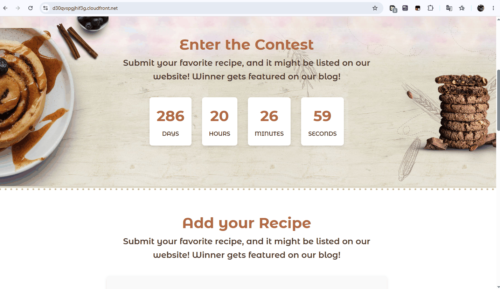<br><sub>Countdown and submission form</sub></td>
    <td width="33%">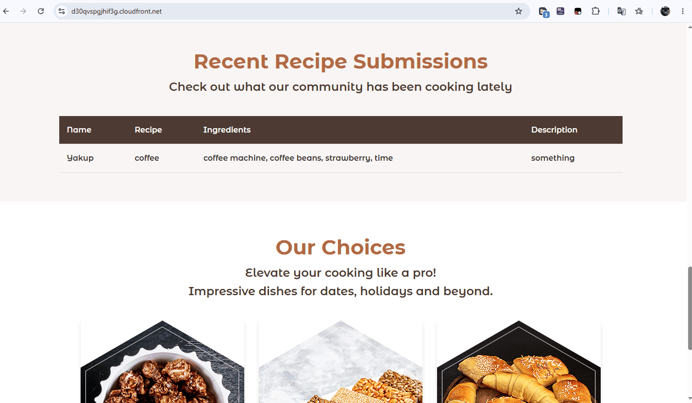<br><sub>Recipes read from DynamoDB via API Gateway + Lambda</sub></td>
  </tr>
</table>

---

## 6. Compared with Project 2

| Concern | Project 2 (Fargate) | **Project 3 (Serverless)** |
| :--- | :--- | :--- |
| Networking | VPC, 12 subnets, NAT Gateway, security groups | **None to manage** |
| Compute | Always-on containers (2 + 2 tasks) | **Runs only when invoked** |
| Database | RDS MySQL + secret rotation | **DynamoDB**, no credentials to rotate (access via IAM role) |
| Frontend | Next.js server | **Static files** on S3 + CDN |
| Latency | Single region | **Edge caching** with CloudFront |
| Scaling | Configure service scaling | **Automatic, per request** |
| Cost model | Pay for running capacity (tasks, NAT, DB) | **Pay per request** |

---

## 7. Folder structure

```text
03-serverless/
├── README.md
├── frontend/
│   ├── index.html          # static site (HTML + CSS + JS)
│   ├── recipe_api.js       # calls API Gateway (set API_URL before deploying)
│   └── images/
├── backend/
│   ├── AddRecipe.py        # Lambda: POST → DynamoDB
│   └── GetRecipe.py        # Lambda: GET  ← DynamoDB
└── docs/images/            # architecture, config tables, console shots, results
```

## 8. Clean-up

Delete resources in reverse order of creation: CloudFront distribution (disable first) → S3 bucket → API Gateway → Lambda functions → DynamoDB table → IAM role.
