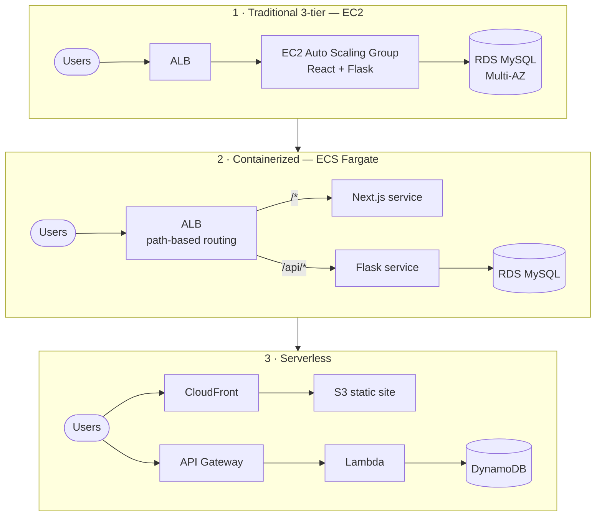

# Ritual Roast on AWS — One Application, Three Architectures

**The same web application, deployed three ways on AWS — from a traditional 3-tier setup on EC2, to containers on ECS Fargate, to a fully serverless design.** Each iteration was built hands-on in the AWS console, documented step by step, and compared against the others.


-232F3E)


---

## The application

**Ritual Roast "Create & Share"** is a recipe-contest web app for a fictional coffee-shop brand. Visitors enter a snack, dessert or beverage recipe through a form; every submission is stored and displayed in a public gallery, and a contest countdown shows the deadline. The head chef picks the winning recipe.

The application is deliberately small and stays functionally the same in every project — which makes it a clean vehicle for comparing **how the architecture, security, operations and cost change** as the hosting model evolves.

<table>
  <tr>
    <td width="33%"><br><sub><b>Project 1</b> · React + Flask on EC2</sub></td>
    <td width="33%"><br><sub><b>Project 2</b> · Next.js + Flask on Fargate</sub></td>
    <td width="33%"><br><sub><b>Project 3</b> · Static site + Lambda</sub></td>
  </tr>
</table>

---

## The three projects at a glance



| | Project | What it demonstrates | Details |
| :--: | :--- | :--- | :--- |
| **1** | **Traditional 3-tier on EC2** | Custom multi-AZ VPC, ALB, Auto Scaling Group, Multi-AZ RDS, Secrets Manager rotation, layered security groups | [📂 Open →](01-three-tier-ec2/README.md) |
| **2** | **Containerized on ECS Fargate** | Docker, ECR, ECS services & task definitions, path-based ALB routing, independent frontend / backend scaling | [📂 Open →](02-containerized-ecs-fargate/README.md) |
| **3** | **Serverless** | S3 + CloudFront (OAC, WAF), API Gateway, Lambda, DynamoDB — no VPC, no servers | [📂 Open →](03-serverless/README.md) |

---

## How the architecture evolved

| | **1 · EC2 3-tier** | **2 · ECS Fargate** | **3 · Serverless** |
| :--- | :--- | :--- | :--- |
| **Migration style** | Traditional baseline | Replatform | Refactor / re-architect |
| **Frontend** | React build served by Flask | Next.js 15 container | Static HTML / CSS / JS on S3 |
| **Backend** | Flask on EC2 | Flask container | Python Lambda functions |
| **Entry point** | Application Load Balancer | ALB with path-based rules | CloudFront + API Gateway |
| **Compute** | EC2 + Auto Scaling Group | Fargate tasks | Lambda (per invocation) |
| **Database** | RDS MySQL (Multi-AZ) | RDS MySQL | DynamoDB (on-demand) |
| **Secrets** | Secrets Manager, 7-day rotation | Secrets Manager, 7-day rotation | IAM role — no database password |
| **Network** | Custom VPC, 4 tiers, NAT | Custom VPC, 4 tiers, NAT | None to manage |
| **Scaling** | Scale the whole app | Scale each service independently | Automatic, per request |
| **Servers to patch** | Yes (EC2 OS) | No | No |
| **Deployment** | Upload to S3, instances pull at boot | Build image → ECR → update service | Upload files to S3, deploy API stage |
| **Idle cost** | Highest (instances, NAT, standby DB) | High (tasks, NAT, DB) | Lowest (pay per request) |
| **Operational effort** | High | Medium | Low |

> Cost figures are qualitative, except for the planning estimate for Project 1 ([see it](01-three-tier-ec2/README.md#6-cost-estimate-planning-exercise)).

### Which one would I choose?

- **EC2 + ASG** — when you need full control of the OS, lift-and-shift of an existing app, or long-running processes.
- **ECS Fargate** — when the app is already containerized, has multiple services that must scale independently, or needs a relational database, but nobody wants to run servers.
- **Serverless** — for spiky or low-traffic workloads, small teams that don't want to operate infrastructure, and cost-sensitive projects.

---

## Skills demonstrated

| Area | What's covered |
| :--- | :--- |
| **Networking** | Custom VPC design, CIDR planning, public / private / data subnets across AZs, route tables, IGW, NAT Gateway |
| **Compute** | EC2, launch templates, user data, Auto Scaling, ECS, Fargate, Lambda |
| **Containers** | Dockerfiles for Python and Node.js, Amazon ECR, task definitions, services, target groups |
| **Load balancing & edge** | ALB listeners and rules, health checks, path-based routing, CloudFront, API Gateway |
| **Data** | RDS MySQL (Multi-AZ), DynamoDB data modelling and capacity modes |
| **Security** | Security-group chaining, IAM roles & instance profiles, Secrets Manager rotation, Session Manager, CloudFront OAC, WAF |
| **Architecture** | HLD / LLD diagrams, service-selection analysis, 7 Rs migration strategies, cost estimation |
| **Application** | Flask REST API, Next.js / React / TypeScript, vanilla JS, boto3 |

---

## Repository structure

```text
.
├── README.md                              ← you are here
│
├── 01-three-tier-ec2/                     Project 1 — traditional 3-tier
│   ├── README.md
│   ├── app/                               Flask backend, React build, EC2 user-data script
│   └── docs/                              step-by-step configuration pages + screenshots
│
├── 02-containerized-ecs-fargate/          Project 2 — containers
│   ├── README.md
│   ├── frontend/                          Next.js app + Dockerfile
│   ├── backend/                           Flask API + Dockerfile
│   └── docs/                              architecture, configuration, screenshots
│
└── 03-serverless/                         Project 3 — serverless
    ├── README.md
    ├── frontend/                          static site (HTML / CSS / JS)
    ├── backend/                           Lambda functions (Python)
    └── docs/                              architecture, configuration, screenshots
```

Every project follows the same layout, and each `docs/images/` folder is organised as:

| Folder | Content |
| :--- | :--- |
| `architecture/` | Customer-flow, high-level and low-level design diagrams |
| `config-tables/` | Design / configuration summary tables |
| `console/` | AWS console screenshots proving each resource was created |
| `results/` | The running application |

---

## Notes on running this yourself

- All projects target the **London (`eu-west-2`)** region; change the region in the code if you deploy elsewhere.
- These are learning projects. **Running them creates billable resources** (NAT Gateways, RDS, load balancers and Fargate tasks cost money while idle). Follow the *Clean-up* section at the end of each project README.
- **No secrets are stored in this repository.** Database credentials live in AWS Secrets Manager, and AWS account identifiers in the screenshots have been masked. Placeholders such as `<account-id>` and `<api-id>` must be replaced with your own values.


